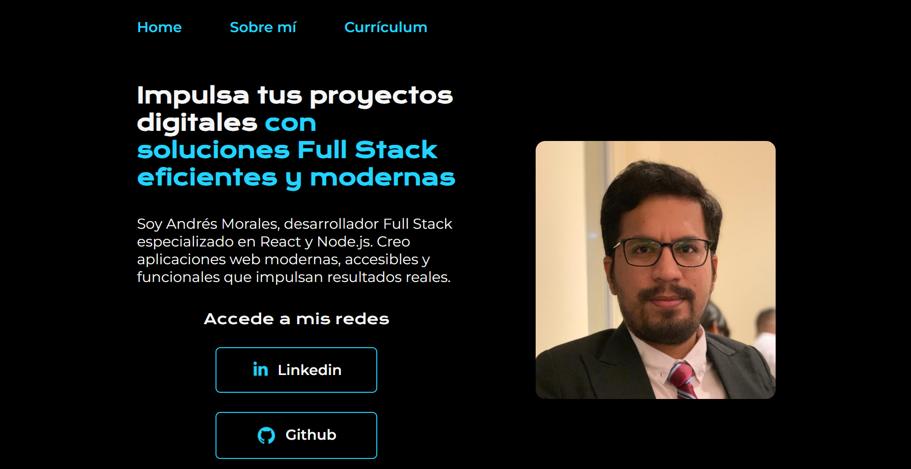
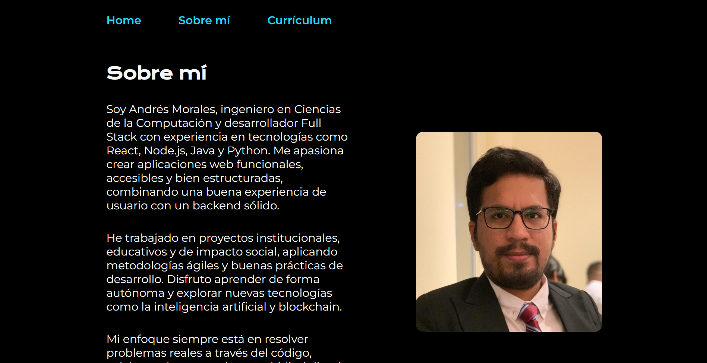
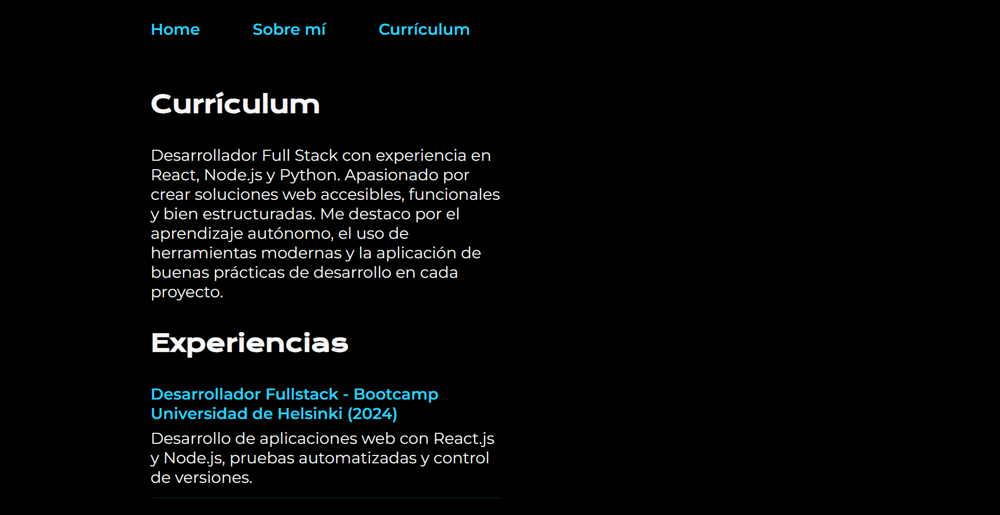

# Portafolio de Andrés Morales

¡Hola y bienvenido! Este es mi proyecto de portafolio personal, donde presento quién soy, mi experiencia y habilidades en desarrollo web. Aquí podrás explorar una muestra de mi trabajo y acceder a mi currículum.
## 🚀 Demo en vivo

**[👉 Ver sitio desplegado](https://portafolio-five-theta-75.vercel.app/)**

---

### 🏠 Inicio

### 👨‍💻 Sobre mí

### 📄 Currículum

---

## ✍️ Autor

**Andrés Morales**  
Desarrollador Full Stack con formación en ingeniería en ciencias de la computación. Apasionado por crear soluciones web funcionales y accesibles, con experiencia en tecnologías como React, Node.js, HTML, CSS y más.

---

## 🌐 Conecta conmigo

- [LinkedIn – Andrés Morales](https://www.linkedin.com/in/imandresmorales/)

