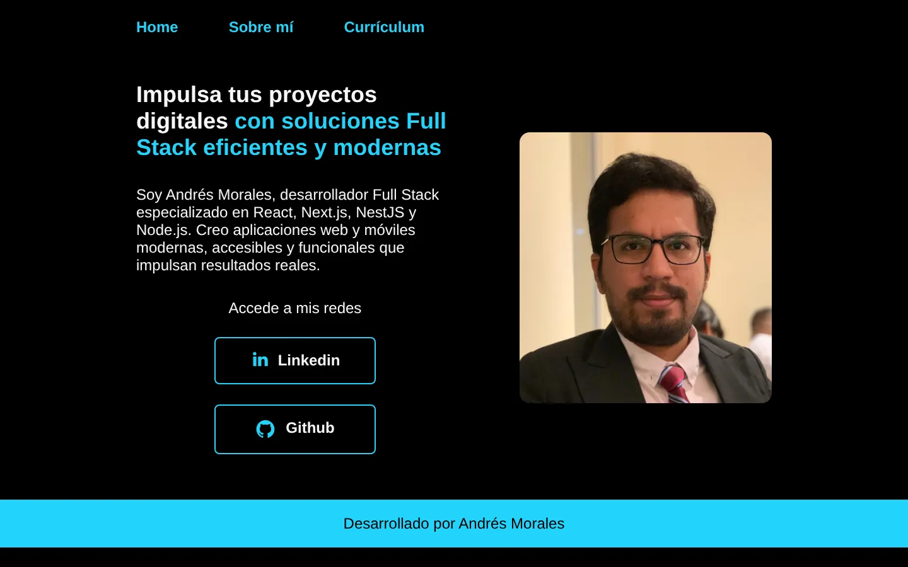
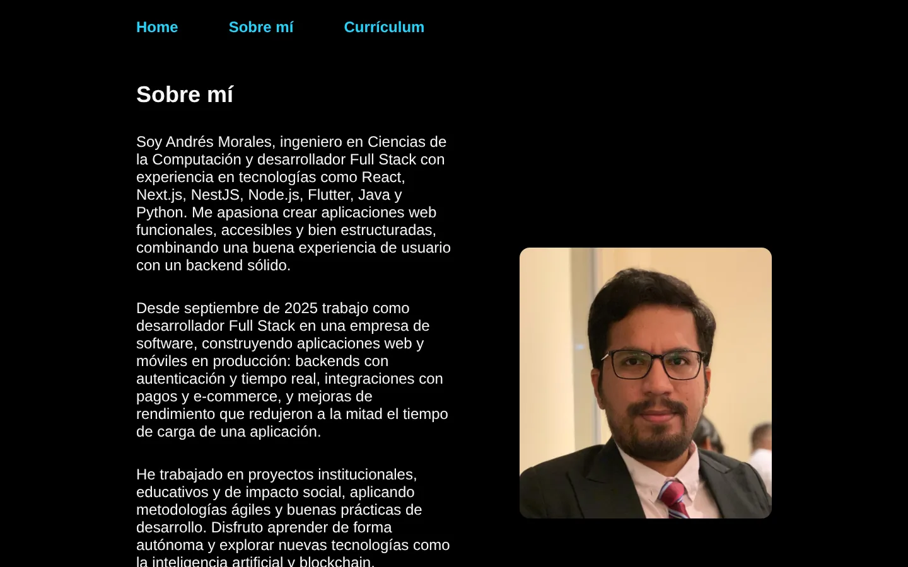
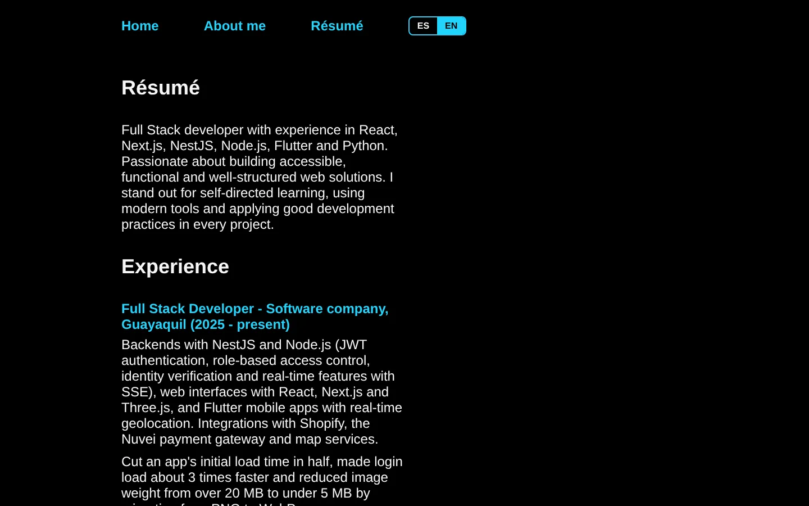

# Portafolio de Andrés Morales

Portafolio personal donde presento quién soy, mi experiencia como desarrollador Full Stack, mis estudios, certificaciones y habilidades técnicas.

**[👉 Ver sitio en vivo](https://portafolio-five-theta-75.vercel.app/)**



## ✨ Características

- Sitio estático de tres páginas: **Inicio**, **Sobre mí** y **Currículum**.
- Diseño responsive con Flexbox y media queries.
- CSS organizado con metodología **BEM** y variables CSS para colores y tipografías.
- Etiquetas `title` y `meta description` por página para buscadores.
- Imágenes en formato **WebP** para una carga más ligera.
- Cabeceras de seguridad configuradas en Vercel (`vercel.json`).

## 🛠️ Tecnologías

- HTML5
- CSS3 (variables, Flexbox, media queries, BEM)
- Google Fonts (Krona One y Montserrat)
- Despliegue en Vercel

## 📸 Capturas

| Sobre mí | Currículum |
| --- | --- |
|  |  |

## 🚀 Ejecutar en local

No necesita dependencias ni compilación.

```bash
git clone https://github.com/imandresmorales/portafolio.git
cd portafolio
```

Abre `index.html` en tu navegador, o usa una extensión como Live Server en VS Code.

## 📁 Estructura

```text
portafolio/
├── index.html        # Inicio
├── about.html        # Sobre mí
├── curriculum.html   # Experiencia, estudios y habilidades
├── styles/
│   └── style.css     # Estilos globales
├── assets/           # Imágenes e íconos
└── vercel.json       # Cabeceras de seguridad para el despliegue
```

## ✍️ Autor

**Andrés Morales**, desarrollador Full Stack con formación en Ingeniería en Ciencias de la Computación (ESPOL). Trabajo con React, Next.js, NestJS, Node.js y Flutter.

- [LinkedIn](https://www.linkedin.com/in/imandresmorales/)
- [GitHub](https://github.com/imandresmorales)
